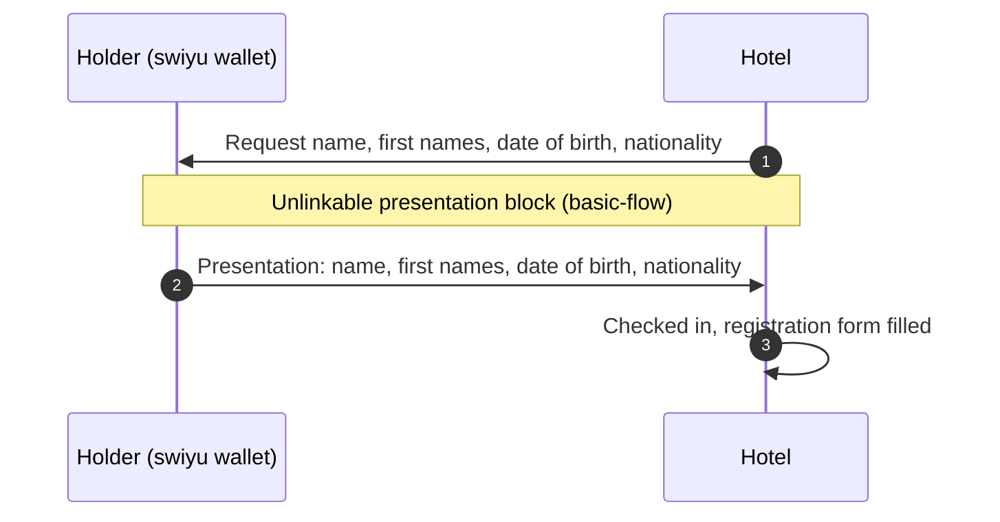

# Hotel check-in

At check-in, the hotel fills in the guest registration form from the guest's e-ID. The guest presents only the four attributes the form needs.

The presentation step is the [unlinkable presentation](../basic-flow/Unlinkable%20e-ID%20use/unlinkable-presentation.md) block.
This flow adds what is specific to the hotel: the claims it requests, the legal
basis and what follows. It is step 3 of the [six-verifier walkthrough](../basic-flow/Unlinkable%20e-ID%20use/six-verifier-walkthrough.md).

Use case: [#70](https://github.com/DIDAS-swiss/use-case-repository/issues/70).

## Diagram

## Interface

| | State |
| --- | --- |
| Requires | `identity-verified`, established by the unlinkable presentation block |
| Establishes | `statutory-identification-recorded` |

## Legal basis

| Rule | Content | Basis |
| --- | --- | --- |
| Guest registration | Commercial hosts report foreign guests to the cantonal authority on a registration form filled in from the identity document | AIG [Art. 16](https://www.fedlex.admin.ch/eli/cc/2007/758/de#art_16), VZAE [Art. 18 para. 1](https://www.fedlex.admin.ch/eli/cc/2007/759/de#art_18) |
| In-person alternative | Whoever accepts the e-ID must also accept an identity document when the holder appears in person | BGEID [Art. 25](https://www.fedlex.admin.ch/eli/fga/2025/20/de#art_25), not yet in force |

Read on Fedlex on 2026-11-11 in the version in force on that day, for the
BGEID in the referendum text.

## Open points

1. **Swiss guests.** AIG Art. 16 and VZAE Art. 18 apply to foreign guests. Cantonal rules for Swiss guests were not checked.
2. **Identity document.** VZAE Art. 18 para. 1 requires the form to be filled in from the identity document ("Ausweispapier"). Whether an e-ID presentation meets that requirement is open ([#70](https://github.com/DIDAS-swiss/use-case-repository/issues/70)). Most foreign tourists cannot obtain the e-ID, so the document-based route remains.
