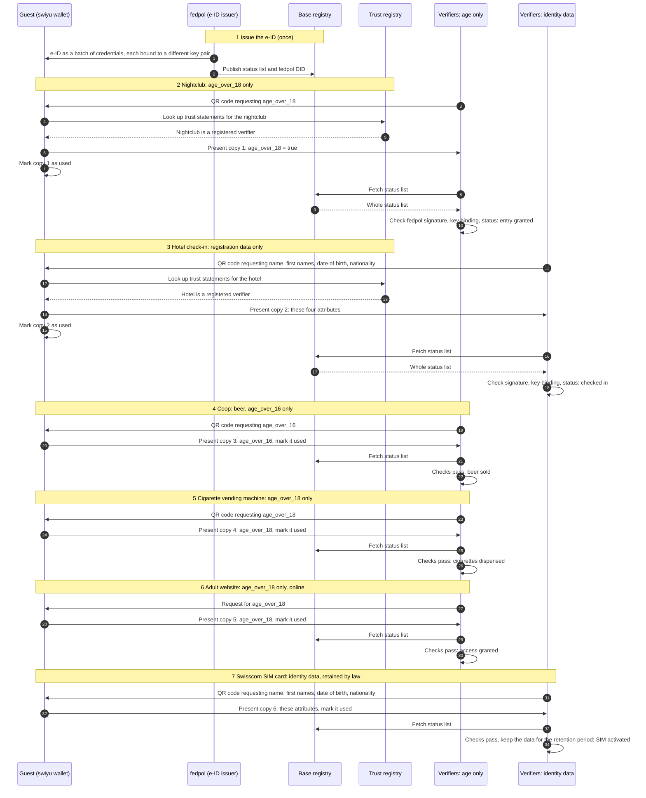

# Unlinkable e-ID use: nightclub, hotel, Coop, vending machine, adult website, Swisscom

One guest uses the same e-ID at six verifiers. Each verifier receives only the
attributes it requests for its purpose, and each presentation uses a different
credential from the batch, with its own key pair. The verifiers that receive
only an age attribute receive no attribute that identifies the guest. The
verifiers that need identity data receive the attributes their legal basis
names. Nothing in the e-ID presentations themselves lets two verifiers link
their transactions.

This walkthrough is composed of one reusable block and the sector flows that
use it. Each verifier step is the [unlinkable presentation](./unlinkable-presentation.md)
block with different requested claims; what happens after the presentation
belongs to the sector flow.

| Step | Sector flow | Sector (NOGA 2025) | Requires | Establishes |
| --- | --- | --- | --- | --- |
| 2 | [Nightclub entry](../../food-and-beverage/nightclub-entry.md) | Food and beverage service activities (56) | `age-attribute-proven` | `access-granted` |
| 3 | [Hotel check-in](../../accommodation/hotel-check-in.md) | Accommodation (55) | `identity-verified` | `statutory-identification-recorded` |
| 4 | [Coop beer sale](../../retail/coop-beer-sale.md) | Retail trade (47) | `age-attribute-proven` | `restricted-sale-permitted` |
| 5 | [Cigarette vending machine](../../retail/cigarette-vending-machine.md) | Retail trade (47) | `age-attribute-proven` | `restricted-sale-permitted` |
| 6 | Adult website, see open point below | Not classified | `age-attribute-proven` | none |
| 7 | [SIM registration](../../telecommunications/sim-registration.md) | Telecommunication (61) | `identity-verified` | `statutory-identification-recorded` |

The block establishes `age-attribute-proven` or `identity-verified`, and each
sector flow requires one of them, so `scripts/check-classification.py` derives
the chain from the state interfaces instead of it being drawn by hand.

## Diagram

The wallet's trust-registry lookup is drawn once per verifier in steps 2 and 3
and omitted from steps 4 to 7, where it is the same.

## Who learns what

| Step | Verifier | Requested | Copy | Use case |
| --- | --- | --- | --- | --- |
| 2 | Nightclub | `age_over_18` | 1 | [#4](https://github.com/DIDAS-swiss/use-case-repository/issues/4) |
| 3 | Hotel | name, first names, date of birth, nationality | 2 | [#70](https://github.com/DIDAS-swiss/use-case-repository/issues/70) |
| 4 | Coop (beer) | `age_over_16` | 3 | [#4](https://github.com/DIDAS-swiss/use-case-repository/issues/4) |
| 5 | Cigarette vending machine | `age_over_18` | 4 | [#5](https://github.com/DIDAS-swiss/use-case-repository/issues/5) |
| 6 | Adult website | `age_over_18` | 5 | none yet |
| 7 | Swisscom (SIM card) | name, first names, date of birth, nationality; retained | 6 | [#71](https://github.com/DIDAS-swiss/use-case-repository/issues/71) |

The four age-only verifiers cannot link their transactions to each other or to
the other two through the e-ID. The hotel and Swisscom both hold the guest's
name and date of birth, so they can link their own records through those
attributes. That link comes from the disclosed data, not from the credential.

The mechanisms that keep the presentations unlinked, the e-ID governance and
the general open points are in the [unlinkable presentation](./unlinkable-presentation.md)
block. The legal basis for each verifier is in its sector flow.

## Open points

1. **Adult website.** The legal limit is 16
   ([StGB Art. 197 para. 1](https://www.fedlex.admin.ch/eli/cc/54/757_781_799/de#art_197)).
   A site may still ask for 18. No use case exists for it yet in the
   use-case repository.
   The content is a digital good, unlike the beer and cigarettes in steps 4
   and 5, which are handed over only after the check. The same content can be
   reached without the check, through a VPN, a site operated abroad or other
   means. The age check therefore controls access through the checking site
   only; it does not control access to the content (DIDAS reading).
   Its NOGA division is not decided, so it has no sector flow yet.
