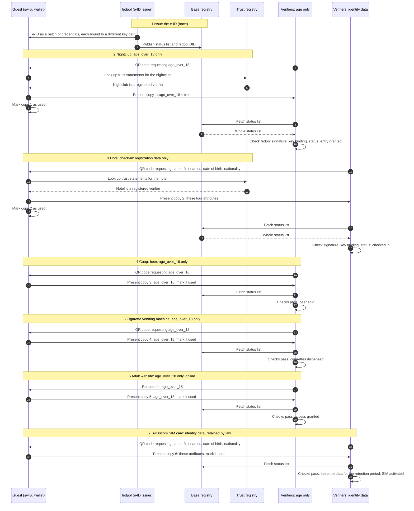

# Unlinkable e-ID use: nightclub, hotel, Coop, vending machine, adult website, Swisscom

One guest uses the same e-ID at six verifiers. Each verifier receives only the
attributes it requests for its purpose, and each presentation uses a different
credential from the batch, with its own key pair. The verifiers that receive
only an age attribute receive no attribute that identifies the guest. The
verifiers that need identity data receive the attributes their legal basis
names. Nothing in the e-ID presentations themselves lets two verifiers link
their transactions.

This flow abstracts registration, issuance and verification as single steps.
[`basic-flow`](../README.md) shows what happens inside them.

## Diagram

The wallet's trust-registry lookup is drawn once per verifier in steps 2 and 3
and omitted from steps 4 to 7, where it is the same.

## Who learns what

| Step | Verifier | Requested | Copy | Use case |
| --- | --- | --- | --- | --- |
| 2 | Nightclub | `age_over_18` | 1 | [#4](https://github.com/DIDAS-swiss/use-case-repository/issues/4) |
| 3 | Hotel | name, first names, date of birth, nationality | 2 | [#70](https://github.com/DIDAS-swiss/use-case-repository/issues/70) |
| 4 | Coop (beer) | `age_over_16` | 3 | [#4](https://github.com/DIDAS-swiss/use-case-repository/issues/4) |
| 5 | Cigarette vending machine | `age_over_18` | 4 | [#5](https://github.com/DIDAS-swiss/use-case-repository/issues/5) |
| 6 | Adult website | `age_over_18` | 5 | none yet |
| 7 | Swisscom (SIM card) | name, first names, date of birth, nationality; retained | 6 | [#71](https://github.com/DIDAS-swiss/use-case-repository/issues/71) |

The four age-only verifiers cannot link their transactions to each other or to
the other two through the e-ID. The hotel and Swisscom both hold the guest's
name and date of birth, so they can link their own records through those
attributes. That link comes from the disclosed data, not from the credential.

## What keeps the presentations unlinked

Each mechanism below is stated with the source it was checked against.

| Mechanism | What it does | Source |
| --- | --- | --- |
| Batch issuance | The issuer sends one credential per holder proof, with the same data and a different key binding. Batch issuance is recommended for privacy-relevant use cases, and the batch size must be at least 10. | Swiss Profile Issuance, [L195–L196](https://github.com/swiyu-admin-ch/swiyu-admin-ch.github.io/blob/df9b16895a2dee8a2287d2071be5b31d17237d92/_specifications/swiss-profile-issuance.md#L195-L196) and [§ 14.6, § 14.A, L251–L260](https://github.com/swiyu-admin-ch/swiyu-admin-ch.github.io/blob/df9b16895a2dee8a2287d2071be5b31d17237d92/_specifications/swiss-profile-issuance.md#L251-L260); swiyu-issuer 2.4.0, [CHANGELOG L401](https://github.com/swiyu-admin-ch/swiyu-issuer/blob/22b291cb85f6fc7b6ed4da332a6e04a37f799e24/CHANGELOG.md#L401) |
| Own status list index | Each credential in a batch gets its own index, chosen at random from the free indexes, so the index does not link presentations. | swiyu-issuer 2.2.0, [CHANGELOG L506–L507](https://github.com/swiyu-admin-ch/swiyu-issuer/blob/22b291cb85f6fc7b6ed4da332a6e04a37f799e24/CHANGELOG.md#L506-L507) |
| Same, rounded timestamps | `iat`, `exp` and `nbf` must be the same across a batch and should be rounded, so the issuance time does not link credentials. The issuer software rounds them down. | Swiss Profile Issuance, [L276](https://github.com/swiyu-admin-ch/swiyu-admin-ch.github.io/blob/df9b16895a2dee8a2287d2071be5b31d17237d92/_specifications/swiss-profile-issuance.md#L276); swiyu-issuer 2.4.0, [CHANGELOG L425](https://github.com/swiyu-admin-ch/swiyu-issuer/blob/22b291cb85f6fc7b6ed4da332a6e04a37f799e24/CHANGELOG.md#L425) |
| Status list fetched whole | The verifier fetches the status list from the URL in the credential and reads one index locally. The request names the list, not the credential, and does not go to fedpol. | swiyu-verifier, [StatusListResolver L31–L37](https://github.com/swiyu-admin-ch/swiyu-verifier/blob/0bf4cdc149ef7e0651c1ee82b1f5b2ce35518496/verifier-service/src/main/java/ch/admin/bj/swiyu/verifier/service/statuslist/StatusListResolver.java#L31-L37) |
| Data minimisation | The age-only verifiers request one age claim and no name, date of birth or portrait. A portrait is the same in every presentation and would make them linkable. | Design choice of this flow |

All swiyu sources were read on 2026-11-11 at the commits in the links.

## Governance

The e-ID Act (BGEID) of 20 December 2024 was accepted in the vote of
28 September 2025 ([BBl 2026 1165](https://www.fedlex.admin.ch/eli/fga/2026/1165/de))
and is not yet in force. The Federal Council sets the date (Art. 36 para. 2);
its press release of 30 June 2026 expects the trust infrastructure to start in
the first half of 2027. BGEID articles below cite the referendum text,
[BBl 2025 20](https://www.fedlex.admin.ch/eli/fga/2025/20/de).

| Role | Who | Basis |
| --- | --- | --- |
| Issuer of the e-ID | fedpol | BGEID [Art. 13](https://www.fedlex.admin.ch/eli/fga/2025/20/de#art_13) |
| Base and trust registers | Federal Office of Information Technology (BIT) provides both | BGEID [Art. 2](https://www.fedlex.admin.ch/eli/fga/2025/20/de#art_2), [Art. 3](https://www.fedlex.admin.ch/eli/fga/2025/20/de#art_3) |
| Verifier oversight | A verifier may request e-ID data only where the law provides for an identity check or where it is strictly necessary for the reliability of the transaction. If a verifier breaches this, the BIT records it in the trust register, visible to the holder at a transaction, and can exclude the verifier. | BGEID [Art. 23 para. 1–2](https://www.fedlex.admin.ch/eli/fga/2025/20/de#art_23) |
| In-person alternative | Whoever accepts the e-ID must also accept an identity document under Art. 14 when the holder appears in person | BGEID [Art. 25](https://www.fedlex.admin.ch/eli/fga/2025/20/de#art_25) |
| Beer and wine | No supply to persons under 16 | LMG [Art. 14 para. 1](https://www.fedlex.admin.ch/eli/cc/2017/62/de#art_14) |
| Spirits | No retail supply to persons under 18; retail is licensed and prosecuted by the cantons, FOCBS coordinates | AlkG [Art. 41 para. 1 let. i](https://www.fedlex.admin.ch/eli/cc/48/425_437_457/de#art_41), Art. 41a, 43, 57 para. 5 |
| Tobacco | No supply to minors; vending machines only where minors have no access | TabPG [Art. 23 para. 1 and 3](https://www.fedlex.admin.ch/eli/cc/2024/457/de#art_23) |
| Adult content | Offering pornography to persons under 16 is an offence | StGB [Art. 197 para. 1](https://www.fedlex.admin.ch/eli/cc/54/757_781_799/de#art_197) |
| Hotel guest registration | Commercial hosts report foreign guests to the cantonal authority on a registration form filled in from the identity document | AIG [Art. 16](https://www.fedlex.admin.ch/eli/cc/2007/758/de#art_16), VZAE [Art. 18 para. 1](https://www.fedlex.admin.ch/eli/cc/2007/759/de#art_18) |
| SIM identification | The provider or reseller checks a passport, identity card or foreign national's permit and keeps an electronic copy | VÜPF [Art. 20](https://www.fedlex.admin.ch/eli/cc/2018/32/de#art_20), [Art. 20a](https://www.fedlex.admin.ch/eli/cc/2018/32/de#art_20_a) |
| SIM data retention | Subscriber data for the duration of the customer relationship and 6 months after it ends | BÜPF [Art. 21 para. 2](https://www.fedlex.admin.ch/eli/cc/2018/31/de#art_21), VÜPF Art. 21 para. 4 |

All legal texts were read on Fedlex on 2026-11-11 in the version in force on
that day, or for the BGEID in the referendum text.

## Open points

1. **Single use of each copy is a wallet behaviour, not a guarantee.** The
   Swiss Profile states that no wallet is guaranteed to use a credential from a
   batch only once, and that issuers and verifiers should not rely on it
   ([§ 14.6](https://github.com/swiyu-admin-ch/swiyu-admin-ch.github.io/blob/df9b16895a2dee8a2287d2071be5b31d17237d92/_specifications/swiss-profile-issuance.md#L251-L256)).
   The "mark as used" steps describe the wallet behaviour this flow assumes.
2. **Batch size for the e-ID.** The board gives 25 credentials per batch, citing
   the swiyu issuer architecture (section 16.4.1) and a participation meeting in
   May 2025. That number was not found in the published swiyu specifications;
   the specified minimum is 10.
3. **Holder binding without a portrait.** Each presentation carries a Key
   Binding JWT, signed with the holder key named in the credential's `cnf`
   claim and addressed to the verifier's `client_id`
   ([Swiss Profile VC, § 4.1.2 and § 4.3](https://github.com/swiyu-admin-ch/swiyu-admin-ch.github.io/blob/df9b16895a2dee8a2287d2071be5b31d17237d92/_specifications/swiss-profile-vc.md#L165-L181)).
   This flow treats that binding as sufficient for every verifier, in person
   and online, when the presentation comes from the e-ID or from a credential
   derived from it and bound directly to the same holder (DIDAS position).
   No portrait is needed for it. Use case
   [#5](https://github.com/DIDAS-swiss/use-case-repository/issues/5) raises the
   question for unattended machines.
4. **Linking outside the e-ID.** Time, place, IP address or payment data can
   still link visits. That is outside the e-ID and outside this flow.
5. **Hotel.** AIG Art. 16 and VZAE Art. 18 set the registration duty for
   foreign guests, and the form is filled in from the identity document
   ("Ausweispapier"). Cantonal rules for Swiss guests were not checked. Whether
   an e-ID presentation meets the identity-document requirement is open
   ([#70](https://github.com/DIDAS-swiss/use-case-repository/issues/70)).
6. **SIM registration.** VÜPF Art. 20a accepts a passport, an identity card or
   a foreign national's permit, and requires an electronic copy of it. The
   e-ID is not listed, so an e-ID-only SIM registration is not covered by the
   ordinance in force
   ([#71](https://github.com/DIDAS-swiss/use-case-repository/issues/71)). It
   also captures more than this flow requests: document type, number and
   issuer, and the address.
7. **Adult content.** The legal limit is 16 (StGB Art. 197). A site may still
   ask for 18. No use case exists for it yet in the use-case repository.
   The content is a digital good, unlike the beer and cigarettes in steps 4
   and 5, which are handed over only after the check. The same content can be
   reached without the check, through a VPN, a site operated abroad or other
   means. The age check therefore controls access through the checking site
   only; it does not control access to the content (DIDAS reading).
8. **Vending machines.** The TabPG amendment of 20 June 2025
   ([BBl 2025 2038](https://www.fedlex.admin.ch/eli/fga/2025/2038/de)) adds
   Art. 23a, an age-check system for sales through vending machines and the
   internet; it is not yet in force. The draft TabPV revision (consultation
   closed 20 March 2026) requires the check before the product is dispensed and
   lists the e-ID among the accepted proofs of age (draft Art. 20f, 20g).
