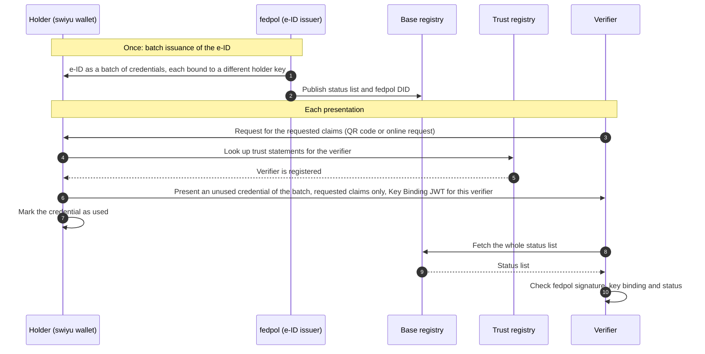

# Unlinkable presentation of the e-ID

A reusable building block. One verifier requests a set of claims from the
e-ID, and the wallet answers with a credential from the batch that it has not
presented before, disclosing only the requested claims. Nothing in the
presentation lets this verifier link it to presentations made to other
verifiers ([unlinkability](https://didas-swiss.github.io/didas-glossary/#term:unlinkability)).

Sector flows use this block for their presentation step and add what is
specific to them: which claims they request, on which legal basis, and what
the verifier does with the result. The block requires `eid-held` and, depending
on the requested claims, establishes `age-attribute-proven` or
`identity-verified`, which is the state the sector flows require. The
[six-verifier walkthrough](./six-verifier-walkthrough.md) shows the block used
by six verifiers in five sectors.

It specialises the issuance and verification views of the
[basic flow](../README.md).

## Diagram

## What keeps the presentations unlinked

Each mechanism is stated with the source it was checked against.

| Mechanism | What it does | Source |
| --- | --- | --- |
| [Batch issuance](https://didas-swiss.github.io/didas-glossary/#term:batch-issuance) | The issuer sends one credential per holder proof, with the same data and a different key binding. Batch issuance is recommended for privacy-relevant use cases, and the batch size must be at least 10. | Swiss Profile Issuance, [L195–L196](https://github.com/swiyu-admin-ch/swiyu-admin-ch.github.io/blob/df9b16895a2dee8a2287d2071be5b31d17237d92/_specifications/swiss-profile-issuance.md#L195-L196) and [§ 14.6, § 14.A, L251–L260](https://github.com/swiyu-admin-ch/swiyu-admin-ch.github.io/blob/df9b16895a2dee8a2287d2071be5b31d17237d92/_specifications/swiss-profile-issuance.md#L251-L260); swiyu-issuer 2.4.0, [CHANGELOG L401](https://github.com/swiyu-admin-ch/swiyu-issuer/blob/22b291cb85f6fc7b6ed4da332a6e04a37f799e24/CHANGELOG.md#L401) |
| Own [status list](https://didas-swiss.github.io/didas-glossary/#term:status-list) index | Each credential in a batch gets its own index, chosen at random from the free indexes, so the index does not link presentations. | swiyu-issuer 2.2.0, [CHANGELOG L506–L507](https://github.com/swiyu-admin-ch/swiyu-issuer/blob/22b291cb85f6fc7b6ed4da332a6e04a37f799e24/CHANGELOG.md#L506-L507) |
| Same, rounded timestamps | `iat`, `exp` and `nbf` must be the same across a batch and should be rounded, so the issuance time does not link credentials. The issuer software rounds them down. | Swiss Profile Issuance, [L276](https://github.com/swiyu-admin-ch/swiyu-admin-ch.github.io/blob/df9b16895a2dee8a2287d2071be5b31d17237d92/_specifications/swiss-profile-issuance.md#L276); swiyu-issuer 2.4.0, [CHANGELOG L425](https://github.com/swiyu-admin-ch/swiyu-issuer/blob/22b291cb85f6fc7b6ed4da332a6e04a37f799e24/CHANGELOG.md#L425) |
| Status list fetched whole | The verifier fetches the status list from the URL in the credential and reads one index locally. The request names the list, not the credential, and does not go to fedpol. | swiyu-verifier, [StatusListResolver L31–L37](https://github.com/swiyu-admin-ch/swiyu-verifier/blob/0bf4cdc149ef7e0651c1ee82b1f5b2ce35518496/verifier-service/src/main/java/ch/admin/bj/swiyu/verifier/service/statuslist/StatusListResolver.java#L31-L37) |
| Data minimisation | An age-only request asks for one age claim and no name, date of birth or portrait. A portrait is the same in every presentation and would make them linkable. | Set by each flow that uses this block |

All swiyu sources were read on 2026-11-11 at the commits in the links.

## Governance

The e-ID Act (BGEID) of 20 December 2024 was accepted in the vote of
28 September 2025 ([BBl 2026 1165](https://www.fedlex.admin.ch/eli/fga/2026/1165/de))
and is not yet in force. The Federal Council sets the date (Art. 36 para. 2);
its press release of 30 June 2026 expects the trust infrastructure to start in
the first half of 2027. BGEID articles below cite the referendum text,
[BBl 2025 20](https://www.fedlex.admin.ch/eli/fga/2025/20/de).

| Role | Who | Basis |
| --- | --- | --- |
| Issuer of the e-ID | fedpol | BGEID [Art. 13](https://www.fedlex.admin.ch/eli/fga/2025/20/de#art_13) |
| Base and trust registers | Federal Office of Information Technology (BIT) provides both | BGEID [Art. 2](https://www.fedlex.admin.ch/eli/fga/2025/20/de#art_2), [Art. 3](https://www.fedlex.admin.ch/eli/fga/2025/20/de#art_3) |
| Verifier oversight | A verifier may request e-ID data only where the law provides for an identity check or where it is strictly necessary for the reliability of the transaction. If a verifier breaches this, the BIT records it in the trust register, visible to the holder at a transaction, and can exclude the verifier. | BGEID [Art. 23 para. 1–2](https://www.fedlex.admin.ch/eli/fga/2025/20/de#art_23) |
| In-person alternative | Whoever accepts the e-ID must also accept an identity document under Art. 14 when the holder appears in person | BGEID [Art. 25](https://www.fedlex.admin.ch/eli/fga/2025/20/de#art_25) |

All legal texts were read on Fedlex on 2026-11-11, for the BGEID in the
referendum text. Sector-specific legal bases are in the sector flows.

## Open points

1. **Single use of each copy is a wallet behaviour, not a guarantee.** The
   Swiss Profile states that no wallet is guaranteed to use a credential from a
   batch only once, and that issuers and verifiers should not rely on it
   ([§ 14.6](https://github.com/swiyu-admin-ch/swiyu-admin-ch.github.io/blob/df9b16895a2dee8a2287d2071be5b31d17237d92/_specifications/swiss-profile-issuance.md#L251-L256)).
   The "mark as used" step describes the wallet behaviour this block assumes.
2. **Batch size for the e-ID.** The board gives 25 credentials per batch, citing
   the swiyu issuer architecture (section 16.4.1) and a participation meeting in
   May 2025. That number was not found in the published swiyu specifications;
   the specified minimum is 10.
3. **[Holder binding](https://didas-swiss.github.io/didas-glossary/#term:holder-binding) without a portrait.** Each presentation carries a Key
   Binding JWT, signed with the holder key named in the credential's `cnf`
   claim and addressed to the verifier's `client_id`
   ([Swiss Profile VC, § 4.1.2 and § 4.3](https://github.com/swiyu-admin-ch/swiyu-admin-ch.github.io/blob/df9b16895a2dee8a2287d2071be5b31d17237d92/_specifications/swiss-profile-vc.md#L165-L181)).
   This block treats that binding as sufficient for every verifier, in person
   and online, when the presentation comes from the e-ID or from a credential
   derived from it and bound directly to the same holder (DIDAS position).
   No portrait is needed for it. Use case
   [#5](https://github.com/DIDAS-swiss/use-case-repository/issues/5) raises the
   question for unattended machines.
4. **Linking outside the e-ID.** Time, place, IP address or payment data can
   still link visits. That is outside the e-ID and outside this block.
