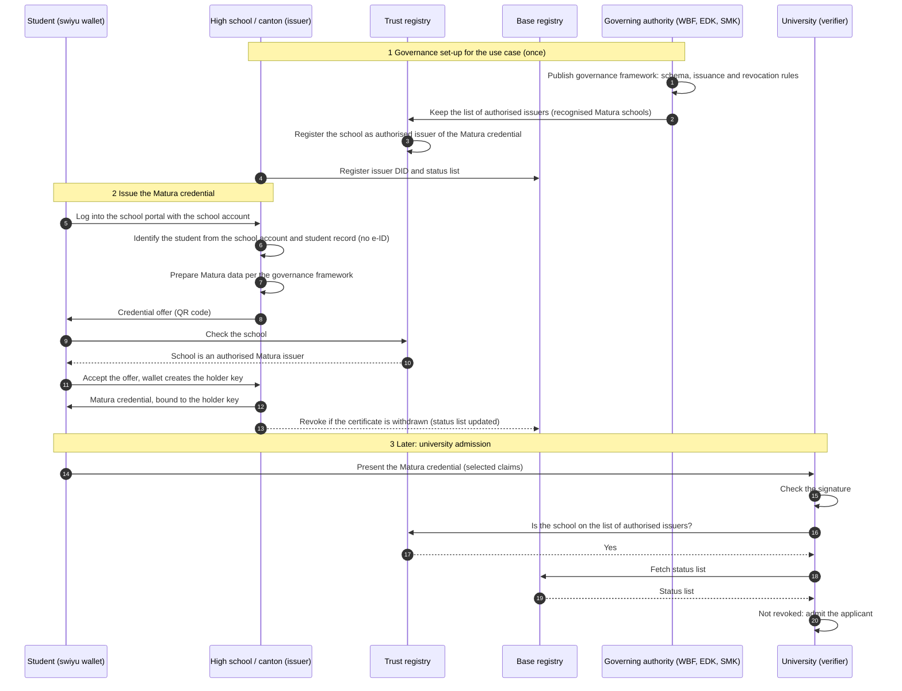

# Issuing a Matura credential without the e-ID

**DIDAS proposal for discussion.** The school identifies the student with the
school account, not the e-ID. A governing authority sets the rules for the
credential and keeps the list of schools authorised to issue it.

This flow extends the
[High school Certificate Issuance](./High%20school%20Certificate%20Issuance.svg)
flow of the same family. It differs in two places: the student is identified
with the school account instead of the e-ID, and a governing authority keeps
the list of schools that may issue the credential. Use case:
[#121 Authenticate a Matura qualification for admission](https://github.com/DIDAS-swiss/use-case-repository/issues/121).

The flow is not built on the [`basic-flow`](../basic-flow/README.md) reference
model. Its trust set-up, with a governing authority and a list of authorised
issuers, has no counterpart there, and which trust infrastructure carries the
credential is not decided.

## Diagram

## How this maps to swiyu

The list of authorised issuers in this flow corresponds to the swiyu mechanism
for protected credential types. A credential type is protected if its `vct` is
on the active Protected Issuance Trust List Statement (piTLS), and its issuers
need a Protected Issuance Authorization Trust Statement (piaTS)
([Trust Protocol 2.0, L67–L73](https://github.com/swiyu-admin-ch/swiyu-admin-ch.github.io/blob/df9b16895a2dee8a2287d2071be5b31d17237d92/_specifications/trust-protocol-v2-0.md#L67-L73)).
Today both statements are issued by the one trust statement issuer named in
swiss-profile-trust
([L61–L66](https://github.com/swiyu-admin-ch/swiyu-admin-ch.github.io/blob/df9b16895a2dee8a2287d2071be5b31d17237d92/_specifications/swiss-profile-trust.md#L61-L66)),
not by a sectoral authority. Letting the education authorities keep this list
themselves is what change request
[CR-DIDAS-0001](https://github.com/DIDAS-swiss/swiyu-change-requests/issues/1)
proposes. Read on 2026-11-11 at the commits in the links.

## Governance

| Role | Who | Basis |
| --- | --- | --- |
| Recognition of Matura certificates | WBF and EDK each approve the application, which the canton submits to the SMK | MAV (SR 413.11, in force since 1 August 2024) [Art. 33 para. 3](https://www.fedlex.admin.ch/eli/cc/2023/373/de#art_33), [Art. 34 para. 1](https://www.fedlex.admin.ch/eli/cc/2023/373/de#art_34) |
| Governance framework for the credential | Not decided | DIDAS proposal |
| List of authorised issuers | Not decided who runs it; in swiyu today, the federal trust statement issuer | DIDAS proposal; swiyu Trust Protocol |
| Issuer | High school or canton | DIDAS proposal |

MAV read on Fedlex on 2026-11-11 in the version in force on that day.

## Open points

1. **Who runs the governance framework and the issuer list.** This is a DIDAS
   proposal; no body has taken it on.
2. **Legal effect.** Can a credential carry the legal effect of the
   certificate? MAV [Art. 27 para. 1 let. h](https://www.fedlex.admin.ch/eli/cc/2023/373/de#art_27)
   requires the certificate to bear the signature of the competent cantonal
   authority and of a member of the school management, and let. b prescribes a
   fixed statement referring to the recognition acts.
3. **Default disclosure.** Which grades does the credential show by default?
4. **Binding to the person.** At admission, the university may additionally ask
   for the e-ID to bind the Matura credential to the applicant. Use case
   [#121](https://github.com/DIDAS-swiss/use-case-repository/issues/121) lists
   "the applicant is the person named on the certificate" as a fact to prove.
