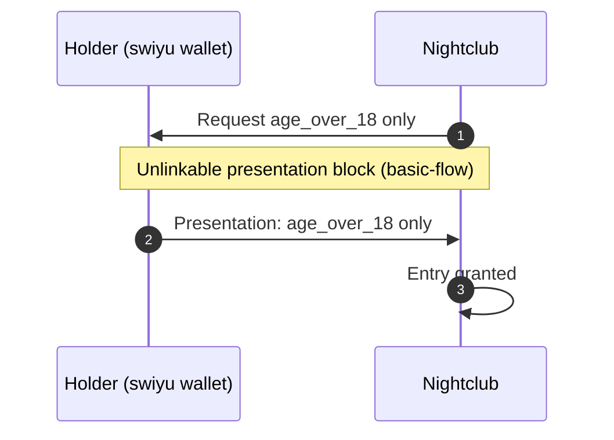

# Nightclub entry

The door staff of a nightclub checks that the guest is at least 18 before letting them in. The guest presents only `age_over_18`; the nightclub learns nothing that identifies the guest.

The presentation step is the [unlinkable presentation](../basic-flow/Unlinkable%20e-ID%20use/unlinkable-presentation.md) block.
This flow adds what is specific to the nightclub: the claims it requests, the legal
basis and what follows. It is step 2 of the [six-verifier walkthrough](../basic-flow/Unlinkable%20e-ID%20use/six-verifier-walkthrough.md).

Use case: [#4](https://github.com/DIDAS-swiss/use-case-repository/issues/4).

## Diagram

## Interface

| | State |
| --- | --- |
| Requires | `age-attribute-proven`, established by the unlinkable presentation block |
| Establishes | `access-granted` |

## Legal basis

| Rule | Content | Basis |
| --- | --- | --- |
| Entry age | 18 is the venue's own rule | House rule |
| Spirits | No retail supply to persons under 18; the cantons license and prosecute | AlkG [Art. 41 para. 1 let. i](https://www.fedlex.admin.ch/eli/cc/48/425_437_457/de#art_41), Art. 57 para. 5 |
| Beer and wine | No supply to persons under 16 | LMG [Art. 14 para. 1](https://www.fedlex.admin.ch/eli/cc/2017/62/de#art_14) |
| In-person alternative | Whoever accepts the e-ID must also accept an identity document when the holder appears in person | BGEID [Art. 25](https://www.fedlex.admin.ch/eli/fga/2025/20/de#art_25), not yet in force |

Read on Fedlex on 2026-11-11 in the version in force on that day, for the
BGEID in the referendum text.

## Open points

1. **Entry rule and serving rule differ.** The law sets the age for serving drinks; the entry age is the venue's choice. Use case [#4](https://github.com/DIDAS-swiss/use-case-repository/issues/4) covers the sale and serving of age-restricted products.
