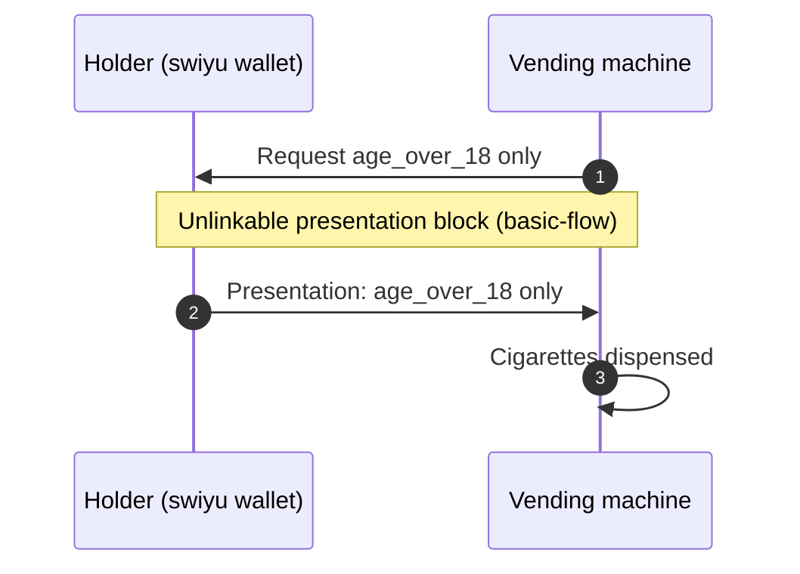

# Cigarette vending machine

A cigarette vending machine checks that the buyer is at least 18 before it dispenses. The machine requests only `age_over_18` and learns nothing that identifies the buyer.

The presentation step is the [unlinkable presentation](../basic-flow/Unlinkable%20e-ID%20use/unlinkable-presentation.md) block.
This flow adds what is specific to the vending machine: the claims it requests, the legal
basis and what follows. It is step 5 of the [six-verifier walkthrough](../basic-flow/Unlinkable%20e-ID%20use/six-verifier-walkthrough.md).

Use case: [#5](https://github.com/DIDAS-swiss/use-case-repository/issues/5).

## Diagram

## Interface

| | State |
| --- | --- |
| Requires | `age-attribute-proven`, established by the unlinkable presentation block |
| Establishes | `restricted-sale-permitted` |

## Legal basis

| Rule | Content | Basis |
| --- | --- | --- |
| Tobacco | No supply to minors; vending machines only where minors have no access | TabPG [Art. 23 para. 1 and 3](https://www.fedlex.admin.ch/eli/cc/2024/457/de#art_23) |
| Age-check system | Required for sales through vending machines and the internet; amendment of 20 June 2025, not yet in force | TabPG Art. 23a ([BBl 2025 2038](https://www.fedlex.admin.ch/eli/fga/2025/2038/de)) |

Read on Fedlex on 2026-11-11 in the version in force on that day, for the
BGEID in the referendum text.

## Open points

1. **Draft ordinance.** The draft TabPV revision (consultation closed 20 March 2026) requires the check before the product is dispensed and lists the e-ID among the accepted proofs of age (draft Art. 20f, 20g).
2. **Unattended machine.** The machine relies on the [holder binding](https://didas-swiss.github.io/didas-glossary/#term:holder-binding) of the presentation; see open point 3 of the [unlinkable presentation](../basic-flow/Unlinkable%20e-ID%20use/unlinkable-presentation.md) block and use case [#5](https://github.com/DIDAS-swiss/use-case-repository/issues/5).
