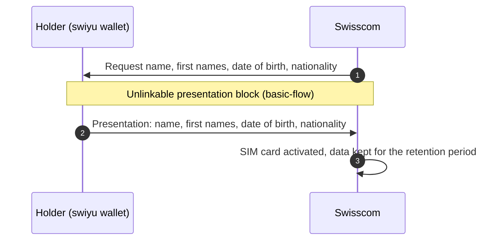

# SIM registration

Before activating a SIM card, the telecommunications provider identifies the subscriber and keeps the data for the period the law sets. The subscriber presents the identity attributes the provider requests.

The presentation step is the [unlinkable presentation](../basic-flow/Unlinkable%20e-ID%20use/unlinkable-presentation.md) block.
This flow adds what is specific to the telecommunications provider: the claims it requests, the legal
basis and what follows. It is step 7 of the [six-verifier walkthrough](../basic-flow/Unlinkable%20e-ID%20use/six-verifier-walkthrough.md).

Use case: [#71](https://github.com/DIDAS-swiss/use-case-repository/issues/71).

## Diagram

## Interface

| | State |
| --- | --- |
| Requires | `identity-verified`, established by the unlinkable presentation block |
| Establishes | `statutory-identification-recorded` |

## Legal basis

| Rule | Content | Basis |
| --- | --- | --- |
| SIM identification | The provider or reseller checks a passport, identity card or foreign national's permit and keeps an electronic copy | VÜPF [Art. 20](https://www.fedlex.admin.ch/eli/cc/2018/32/de#art_20), [Art. 20a](https://www.fedlex.admin.ch/eli/cc/2018/32/de#art_20_a) |
| Retention | Subscriber data for the duration of the customer relationship and 6 months after it ends | BÜPF [Art. 21 para. 2](https://www.fedlex.admin.ch/eli/cc/2018/31/de#art_21), VÜPF Art. 21 para. 4 |
| In-person alternative | Whoever accepts the e-ID must also accept an identity document when the holder appears in person | BGEID [Art. 25](https://www.fedlex.admin.ch/eli/fga/2025/20/de#art_25), not yet in force |

Read on Fedlex on 2026-11-11 in the version in force on that day, for the
BGEID in the referendum text.

## Open points

1. **The e-ID is not an accepted document.** VÜPF Art. 20a lists passport, identity card and foreign national's permit, and requires an electronic copy. An e-ID-only registration is not covered by the ordinance in force ([#71](https://github.com/DIDAS-swiss/use-case-repository/issues/71)).
2. **More data than this flow requests.** VÜPF Art. 20a also captures document type, number and issuer, and the address.
